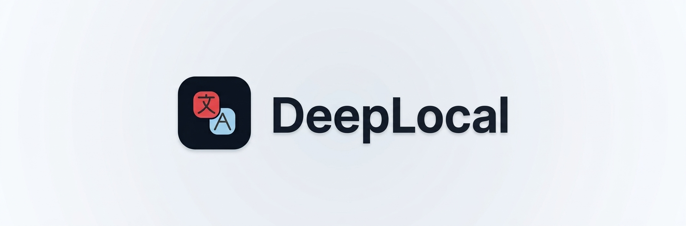
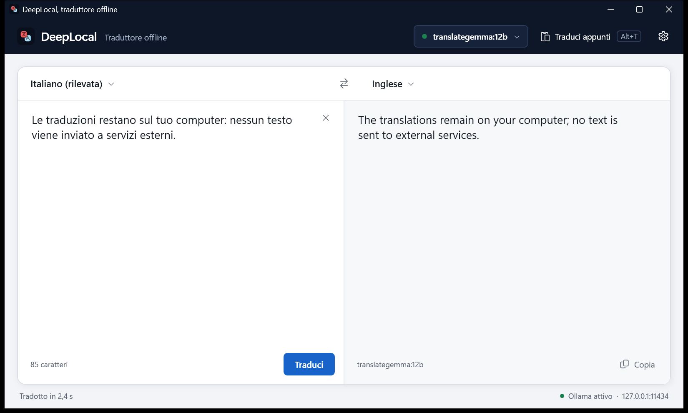
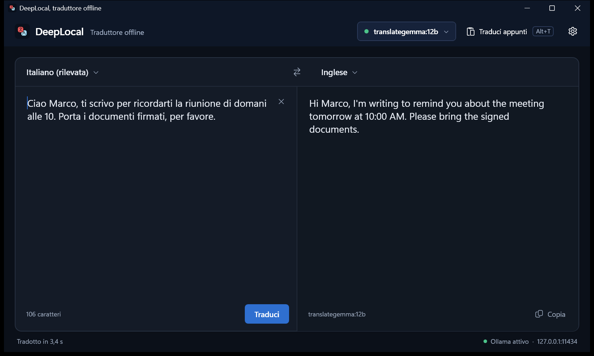

<p align="center">
  
</p>

<h1 align="center">DeepLocal</h1>

<p align="center">
  <b>The DeepL workflow on Windows, fully offline.</b><br>
  Your text never leaves your PC: translations run on local models served by Ollama, with TranslateGemma 12B as the default.
</p>

<p align="center">
  <a href="https://github.com/ShinRalexis/DeepLocal/releases/latest"></a>
  
  
  <a href="https://ollama.com"></a>
  
  
  <a href="#license"></a>
  <a href="https://liberapay.com/MetaDarko/donate"></a>
</p>

<br>

<p align="center">
  <a href="https://github.com/ShinRalexis/DeepLocal/releases/download/v2.0.0/DeepLocal_Setup_EN.exe">
    
  </a>
  &nbsp;
  <a href="https://github.com/ShinRalexis/DeepLocal/releases/download/v2.0.0/DeepLocal_Setup_ITA.exe">
    
  </a>
</p>

<p align="center">
  <sub>DeepLocal 2.0.0 · Windows 10 and 11 (64-bit) · 48 MB installer · no .NET install needed · <a href="https://github.com/ShinRalexis/DeepLocal/releases">all releases</a></sub>
</p>

<br>

| Light theme | Dark theme |
| :---: | :---: |
|  |  |

## Why DeepLocal

- **Private by design.** Nothing is sent to a server: the model runs on your machine through [Ollama](https://ollama.com).
- **Feels like DeepL.** Two joined panes, language bar on top, swap in the middle, text that translates as you type.
- **One key, from any app.** Copy some text, press **Alt+T** and the translation is ready, even with the window hidden in the tray.
- **Any model you like.** TranslateGemma 12B by default, or any other model installed in Ollama, local or cloud.

## Features

### Translation

- Translates as you type, with the text streaming in while the model writes it (can be turned off in Settings)
- **36 languages**, including Portuguese, Polish, Dutch, Ukrainian, Arabic, Korean and Turkish; right-to-left layout for Arabic, Hebrew and Persian
- "Detect language" stays on and shows what it found, for example *Italian (detected)*
- If the text is already in the target language, the target switches by itself (Italian text with target Italian translates into English)
- The swap button swaps languages **and** texts, so the translation becomes the new source
- Clean output: quotes, code fences, "Translation:" labels and reasoning blocks some models add are removed

### Model choice

- **TranslateGemma 12B** is the default, prompted with its official translation format
- The model menu lists every model installed in Ollama, read live: local models first, cloud models marked **Cloud**, embedding models hidden
- Missing TranslateGemma? The menu shows a **Download** button with progress in MB and percent; downloads can be cancelled and resumed
- Models that "think" (deepseek-r1, qwen3, gpt-oss) run with thinking off or at minimum, so translations are faster

### Interface

- Light and dark theme that follows Windows and switches live; on Windows 11 the title bar matches the navy header
- Interface in **English or Italian**, switchable in Settings without restarting
- Clear errors with a button that fixes them (**Start Ollama**, **Retry**, **Open model menu**) instead of HTTP codes
- Ollama status always visible next to the model name, character counter, "Copied" feedback

### Windows integration

- Lives in the tray and comes back with **Alt+T** or a click on the tray icon
- Optional **Start with Windows**, hidden in the tray and ready for Alt+T
- Opening DeepLocal a second time brings the running window to the front
- Settings (model, languages, options) saved in `%APPDATA%\DeepLocal\settings.json`

<details>
<summary><b>What's new in 2.0, and bugs fixed since 1.0</b></summary>

### New in 2.0

- New DeepL-style layout: language bar above two joined panes, swap button in the middle, large readable text.
- Light and dark theme, interface in English or Italian, vector icons instead of emoji, thin scrollbars, keyboard focus rings.
- TranslateGemma 12B as default model, with in-app download and live list of every Ollama model.
- Translate as you type with streaming, Stop button and Esc, Ctrl+Enter to translate immediately.
- 36 languages (was 9), right-to-left support.
- Choosing the same language on both sides swaps them, like DeepL.
- The chosen model is remembered; if it is uninstalled, DeepLocal falls back to TranslateGemma or the first available model and says so.
- Start with Windows option, single instance, warning at startup if Alt+T is already taken by another app.
- Self-contained installers in English and Italian: no .NET install needed, they upgrade 1.0 in place and warn if Ollama is missing.

### Bugs fixed

- Alt+T after closing the window with X translated in the background but the window stayed minimized and invisible: it now always reappears in front.
- The tray menu kept "Open" disabled after the window was closed with X.
- After the first auto-detection the source switched from "Auto" to the detected language for good, so the next text in another language was labelled wrong.
- Japanese text starting with a kanji was detected as Chinese.
- A detected language returned with punctuation (e.g. "Italian.") was rejected as unsupported.
- Large models or slow first loads failed after 100 seconds (HTTP timeout).
- Errors showed only an HTTP code; Ollama's real message (e.g. "model not found") was lost.
- Pressing Alt+T during a translation started a second one in parallel and the results overwrote each other.
- The 1200x720 window with 480 px minimum columns did not fit laptops with 150% scaling.
- The README promised Portuguese and "Enter to translate", which the code did not do.
- Build output (`bin/`, `obj/`) was not ignored by git.

</details>

## Install

1. Install [Ollama for Windows](https://ollama.com/download/windows) and leave it running (it listens on `http://127.0.0.1:11434`).
2. Download the installer with one of the buttons above: **[English](https://github.com/ShinRalexis/DeepLocal/releases/download/v2.0.0/DeepLocal_Setup_EN.exe)** or **[Italiano](https://github.com/ShinRalexis/DeepLocal/releases/download/v2.0.0/DeepLocal_Setup_ITA.exe)**.
3. Run it. It adds Start menu shortcuts, an optional desktop icon and the optional Start with Windows option, and upgrades an existing 1.0 installation in place.
4. Open DeepLocal: if TranslateGemma 12B is missing, click **Download** in the model menu (top right).

**Requirements:** Windows 10 (1809) or Windows 11, 64-bit, and about 8 GB of disk for TranslateGemma 12B.

> [!NOTE]
> SmartScreen may warn about an unsigned app: click **More info**, then **Run anyway**.
> To check the downloads, compare them with [SHA256SUMS.txt](https://github.com/ShinRalexis/DeepLocal/releases/download/v2.0.0/SHA256SUMS.txt).

Previous version: [DeepLocal 1.0.0](https://github.com/ShinRalexis/DeepLocal/releases/tag/v1.0.0)

## Models

DeepLocal selects `translategemma:12b`. You can download it from the model menu or from a terminal:

```bash
ollama pull translategemma:12b
```

Any other model installed in Ollama appears in the same menu (gemma3, aya-expanse, mistral, qwen3, gpt-oss...). Cloud models (`*-cloud`) work too, after `ollama signin`, and are marked **Cloud**.

## Keyboard shortcuts

| Action | Keys |
| --- | --- |
| Translate the clipboard, from any app | Alt+T |
| Translate now | Ctrl+Enter |
| Stop the translation | Esc |
| Show the window | Click on the tray icon |
| Open, translate clipboard, hide, exit | Right click on the tray icon |

Closing or minimizing the window keeps DeepLocal in the tray, ready for Alt+T.

## Troubleshooting

| Problem | What to do |
| --- | --- |
| "Ollama is not responding" | Start Ollama (the error panel has a button for it), then click **Retry**. |
| Model not found | Download it from the model menu, or run `ollama pull <model>`. |
| Alt+T does nothing | Another app uses the same shortcut; the status bar says so at startup. Use the **Translate clipboard** button. |
| Window not visible | Click the tray icon. |

## Build from source

Requires the [.NET 8 SDK](https://dotnet.microsoft.com/download/dotnet/8.0).

```bash
git clone https://github.com/ShinRalexis/DeepLocal.git
cd DeepLocal
dotnet run
```

To build both installers you also need [Inno Setup 6](https://jrsoftware.org/isinfo.php):

```powershell
powershell -ExecutionPolicy Bypass -File installer\build.ps1
```

| Path | What it contains |
| --- | --- |
| `App.xaml(.cs)` | Tray, single instance, startup |
| `MainWindow.xaml(.cs)` | The translator window |
| [`Services/`](Services) | Ollama client, prompts and language detection, settings, UI strings (IT/EN), theme |
| [`Themes/`](Themes) | `Light.xaml`, `Dark.xaml` (colours), `Controls.xaml` (styles) |
| [`installer/`](installer) | Inno Setup script and build script |
| [`docs/`](docs) | PRODUCT.md, DESIGN.md, screenshots |

## Contributing

Fork the repo, create a `feat/feature-name` branch, keep the XAML style consistent (colours in `Themes/`, texts in `Services/Loc.cs`) and open a PR with a description and screenshots.

For bugs or ideas, open an [Issue](https://github.com/ShinRalexis/DeepLocal/issues) with the app version, Windows version, steps and screenshots.

## Support

DeepLocal is free and open source. If it helps you, even $1 is a "hey friend, thanks!" ❤️

<p>
  <a href="https://liberapay.com/MetaDarko/donate"></a>
  <a href="https://www.blockchain.com/explorer/addresses/btc/1NjV2CfyLw42Ej9UmZEcroyqnmmKMJNCUx"></a>
</p>

Bitcoin address: `1NjV2CfyLw42Ej9UmZEcroyqnmmKMJNCUx`

Made by [@MetaDarko](https://github.com/ShinRalexis).

## License

**Code: MIT.** Copyright © 2025-2026 MetaDarko.
Permission is hereby granted, free of charge, to any person obtaining a copy of this software and associated documentation files (the "Software"), to deal in the Software without restriction, including without limitation the rights to use, copy, modify, merge, publish, distribute, sublicense, and/or sell copies of the Software, and to permit persons to whom the Software is furnished to do so, subject to the following conditions: the above copyright notice and this permission notice shall be included in all copies or substantial portions of the Software.
THE SOFTWARE IS PROVIDED "AS IS", WITHOUT WARRANTY OF ANY KIND, EXPRESS OR IMPLIED.

**Images and assets: CC BY 4.0.** The screenshots and graphics in `/docs` and the other graphic assets are © 2025-2026 MetaDarko, distributed under [Creative Commons Attribution 4.0 International](https://creativecommons.org/licenses/by/4.0/): you may use them freely, including commercially, provided that you credit "MetaDarko DeepLocal" and indicate any changes.

TranslateGemma is a Google model distributed under the Gemma Terms of Use. DeepLocal is an independent project and is not affiliated with DeepL SE.
